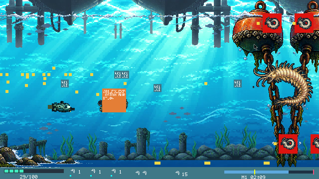

# POLIQUETOS ASESINOS v2 · ENCARGO 03
## B1: pulido de jugabilidad visual, proyectiles, ambiente animado y HUD del mundo 1

**Destinatario:** ChatGPT Codex, repositorio `lsd8245-oss/Poliquetos-asesinos`  
**Fecha:** 1 de noviembre de 2026  
**Motor y producto:** Godot 4.6.3, Windows 10/11 x64, **dos instaladores** Normal/Pruebas. No sustituir por HTML.  
**Rama de partida:** `fix/w01-export-stage-runtime` (confirmar commit y árbol limpio antes de modificar). Crear una nueva rama `pulido/w01-combate-vfx-b1`.  
**Autoridad:** `AGENTS.md`, `docs/specs/poliquetos-asesinos-v2.md`, `docs/procedimientos-v2.md`, `docs/decisiones.md`, `docs/v2-progreso.md` e informe del Encargo 02. La instrucción vigente de plataforma es **Godot/Windows**, aunque haya referencias históricas a HTML.

> **ORDEN DE TRABAJO:** transformar el mundo 1 actualmente funcional pero visualmente incompleto en una experiencia de combate lateral con calidad de videojuego arcade de 16 bits. **Ejecutar únicamente B1 (proyectiles, efectos, animación ambiental, nave y HUD).** B2 (oleadas), B3 (minijefe/jefe) y B4 (tienda/guardados) se describen como etapas futuras y no están autorizadas todavía. No iniciar mundo 2.

---

## 1. Diagnóstico visual fundamentado

**Material entregado por el usuario:** `prueba 1(2).mp4` (22,73 s), `prueba 2.mp4` (84,7 s) y el informe `README(1).md` («Encargo 02: corrección de simulación en exportación»).

**Observado en ambos videos:** ya existe movimiento de nave, desplazamiento de fondo, oleadas, criaturas de gran tamaño y un jefe con barra de vida. El Encargo 02 confirmó y corrigió la carga de controladores de etapas/armas/jefes al exportar y recuperó la actualización del cronómetro. **No afirmar que el juego está completamente detenido.**

**Problemas visibles que este encargo debe resolver:**

1. **Disparos/partículas sin diseño:** abundantes cuadrados y puntos amarillos; no se distingue claramente bala aliada, bala enemiga, impacto o recompensa.
2. **Placeholders en pantalla:** cuadrados grises con rótulos técnicos, cuadros rojos y un cuadro naranja grande con códigos de asset (`W01_...`) interfieren con el combate. Deben rastrearse y reemplazarse, no solo esconderse.
3. **Escenario repetitivo:** aparecen reiteradamente enormes boyas oxidadas con cadenas, algas, pilares y ruinas muy similares. Hay parallax, pero no suficiente variación de siluetas o acontecimientos.
4. **Elementos casi estáticos:** poca animación individual visible en algas, cables, cadenas, fauna de fondo, partículas y agua. Algunas estructuras parecen objetos inmóviles que pasan frente a la cámara.
5. **Contraste y tamaño:** el arte del fondo es muy complejo y brillante en comparación con la nave pequeña; los proyectiles se pierden y el HUD inferior es diminuto.
6. **Sensación de combate:** hay criaturas y jefes, pero faltan señales de ataque, impactos con fuerza, animaciones reconocibles y transición visual clara de jefe.

**No comprobado por los videos:** el conjunto completo de patrones, que se cumplen los 90 enemigos y el tiempo nominal hasta el jefe, compras, guardado al terminar, 60 FPS en Windows real, instalación/desinstalación Windows y mando físico. No convertir pruebas automáticas o Wine en «jugado en Windows físico».

### Capturas tomadas de las grabaciones (para comparar con el resultado)

- [01. Objetos repetidos, video 1 ~17 s](../evidencias/w01-2026-11-01/01-objetos-repetidos.png)
- [02. Proyectiles y cuadros técnicos, video 2 ~11 s](../evidencias/w01-2026-11-01/02-proyectiles-y-placeholders.png)
- [03. Criatura grande, video 2 ~24 s](../evidencias/w01-2026-11-01/03-minijefe-efectos.png)
- [04. Jefe y barra, video 2 ~74 s](../evidencias/w01-2026-11-01/04-jefe-y-legibilidad.png)

---

## 2. B1 — Especificación detallada del trabajo autorizado

### 2.1 Proyectiles: convertir cuadrados de colores en armas y ataques reconocibles

Crear **PNG originales pixel art con animación y atlas** basados en la lista REAL de armas, balas y patrones de `data/combat.json`, `src/weapons/weapons.gd`, `src/stages/stages.gd`, `src/bosses/patterns.gd` y `assets/assets_manifest.json`. No inventar funcionalidades por su apariencia.

| Sistema real | Diseño visual exigido | Animación/impacto |
|---|---|---|
| Disparo básico de la nave | Proyectil mecánico/energético claro, celeste y blanco, con punta/silueta visible sobre agua turquesa; no cuadrado sólido. | 2–4 cuadros de propulsión y estela corta; chispa al colisionar. |
| Niveles superiores de disparo | Geometrías reconocibles para disparo paralelo, múltiple, abanico o haz, según los niveles existentes; no solo multiplicar cuadros. | Intensidad proporcional y destello del enemigo de 2 cuadros. |
| Misiles | Cuerpo alargado, propulsor, pequeñas burbujas o humo pixelado; trayectoria existente preservada. | Explosión de 6–8 cuadros, tamaño conforme al área real de daño. |
| Bomba/área | Activación evidente y onda expansiva acuática o anillo energético, **sin ocultar balas durante demasiado tiempo**. | Expansión y desaparición clara, con daño sincronizado. |
| Bala enemiga común | Forma orgánica o bioluminiscente de color ámbar/magenta, distinta del disparo aliado **también por silueta**, borde legible. | Efecto específico al tocar escudo o nave. |
| Bala enemiga dirigida, rebotante, ráfaga o jefe | Diseños distintivos **solo para tipos presentes en el motor**: espina, cápsula orgánica, orbe, etc. | Telegráfico cuando sea un ataque potente; trayectoria y velocidad originales. |
| Ítems, monedas y portadoras | Iconos PNG claros de arma/escudo/moneda; no paneles rojos/naranja ni etiquetas `W01_...`. Flotación, parpadeo o giro pixelado. | Pulso al recoger y feedback en el HUD. |

**Reglas obligatorias:**

- Usar sprites PNG reales y atlas con `image-rendering`/filtro vecino más cercano. Los dibujos por primitivas de código son únicamente para F3/colisiones, nunca para el arte final.
- Preservar **DPS, daño, cadencia, dirección, velocidad, colisiones y hitboxes**. El tamaño VISUAL puede ampliarse ligeramente para visibilidad, pero el cuerpo colisionable debe coincidir con el núcleo del sprite; documentar diferencias.
- Mantener identidad retro: pocos tonos por sprite, contorno/paleta coherentes, 2–6 cuadros de proyectil, 4–8 cuadros para impacto según complejidad (cifras orientativas, no excusa para mala animación).
- Diferenciar por **forma además de color** para legibilidad y accesibilidad. Probar combate normal, enemigo, misil, bomba y al menos un patrón especial.
- Evitar blur, filtros suaves, bloom que diluya la pixelación o partículas que saturen el primer plano.
- Añadir sprites a `assets/assets_manifest.json`, atlas W01 y rutas correctas. El EXE exportado debe cargarlos desde su paquete, sin depender de assets externos del checkout.

### 2.2 Escenario: que el mundo 1 sea dinámico, no un fondo repetido

Mantener la dirección artística actual: **superficie marina azul luminosa, ruinas costeras, cadenas, estructuras humanas sumergidas y fauna marina**. Aprovechar las **4 capas de parallax** ya existentes, pero cambiar variedad y animación.

1. **Mínimo tres sectores visuales diferenciables** durante el recorrido W01: comienzo con costa/pilares; zona intermedia con ruinas, estructuras irregulares y algas; aproximación al jefe con mayor densidad de estructura y señales de peligro. Transiciones progresivas, sin flash o corte de imagen.
2. **Variaciones modulares:** crear varias siluetas de rocas, postes, restos, boyas y cadenas; alternar tamaño, altura, separación, profundidad y orientación. No colocar el mismo par de grandes boyas cada pocos segundos. Puede usarse una secuencia de piezas con semilla reproducible.
3. **Animación ambiental independiente:** algas/corales blandos que oscilan, pequeñas burbujas ascendentes, partículas de plancton, bancos de peces ocasionales, sedimento en suspensión y rayos/caústicas que varían suavemente.
4. **Movimiento físico discreto de objetos:** algunas cadenas, cables, boyas y algas deben balancearse, con velocidades y fases distintas. No mover todas en sincronía ni hacer que los fondos mareen.
5. **Separación por profundidad:** capas lejanas lentas, medias moderadas y primer plano más rápido; fondo menos saturado/contrastado que balas, nave y enemigos. Revisar la unión de tiles y atlas para evitar costuras visibles.
6. **Legibilidad y colisiones:** indicar claramente qué objetos son decorativos y cuáles hacen daño. No dibujar un poste que parece bloquear físicamente la nave si la nave puede atravesarlo sin consecuencia.
7. **Prueba continua obligatoria:** video de 30 s del W01 donde se vean tres vistas claramente distintas, con parallax fluido y sin repetición inmediata del mismo conjunto de objetos.
8. No alterar la duración oficial del mundo ni la cronología de oleadas solo para sincronizar fondos.

### 2.3 Animaciones de la nave y de las criaturas

- La nave científica actual **se conserva**; mejorar estela, propulsores, balanceo/inclinación al subir/bajar y cambio de dirección. Debe seguir respondiendo de forma precisa en 8 direcciones, con disparo simultáneo, sin física resbaladiza innecesaria.
- La silueta debe destacar sobre el escenario. No resolver falta de legibilidad aumentando mucho su tamaño y rompiendo colisiones; buscar contraste, contorno y estela.
- Cada poliqueto conserva su identificación/taxonomía; animar movimiento de cuerpo segmentado, palpos, quetas o apéndices según anatomía. **No reemplazar especies por gusanos genéricos**.
- Si un ataque fuerte está por dispararse, mostrar señales mediante pose, contracción, brillo puntual o animación preparatoria. Los disparos normales no necesitan todos el mismo telegráfico.
- Al impactar: brillo, dos cuadros de reacción, efecto de golpe y sonido existente. Al morir: partículas/burbujas y desintegración de 4–8 cuadros; el enemigo no debe simplemente desaparecer.
- Al recibir daño: reacción clara de la nave, parpadeo moderado y respuesta del escudo; respetar opción «Reducir destellos» y la invulnerabilidad existente.

### 2.4 Eliminar placeholders visibles y corregir los FX

- Rastrear **cada recuadro naranja, rojo o gris con texto técnico** en los videos al nombre y ruta exactos del asset o a la función de depuración. Crear una tabla de auditoría con `captura → clave → ruta → causa → recurso final → validación`.
- Si es imagen placeholder, producir PNG original reemplazándolo en el manifiesto; si es capa de depuración, mostrarla **solo con F3**. No ocultar información de juego sin crear el icono funcional que la sustituya.
- Efectos separados: disparo, colisión, explosión pequeña/mediana/grande, impacto en escudo, recoger moneda, explosión de jefe. Evitar usar el mismo spritesheet para todos.
- Mantener orden de dibujo: fondo → elementos decorativos → enemigos/partes → nave → balas → FX delanteros e ítems → HUD. Corregir solapamientos que oculten punto débil, ataque o jugador.
- Introducción a minijefe/jefe reconocible; barra superior y nombre/fase nunca cortados ni tapados. **No cambiar las fases, HP ni los patrones** en este bloque.

### 2.5 HUD e iconos de equipo oceanográfico

- Resolución lógica 640×360, campo 640×336, HUD inferior 24 px según especificación; escalar ×1/×2/×3 con píxel nítido y sin recortes. Si la información no cabe, proponer solución sin ocupar la mitad del área de juego.
- Rediseñar iconos PNG de escudo/vida, arma/nivel, misiles, bombas, monedas y avance. El texto no puede ser microscópico; mantener jerarquía visual.
- **Equipos oceanográficos:** icono reconocible relativamente grande, nombre abreviado y/o tecla, **recuadro propio con color identificable y fondo semitransparente**; estado «listo / recarga / bloqueado» legible. No usar paneles opacos que oculten sprites.
- El HUD debe dar feedback de daño, recuperación, compra/recogida y cambios de armas sin animación intrusiva.
- La barra del jefe, nombre y fase deben estar totalmente dentro del área segura y ser distinguibles de las texturas del agua.
- Comprobar legibilidad con capturas de 640×360, 1280×720 y 1920×1080.

---

## 3. Qué NO debe modificar Codex en B1

- **No rehacer motor, economía, tienda, armas, guardados o scripts de jefe** si basta con integrar sprites y mejorar render/respuesta visual; conservar las clases existentes y sus datos.
- **No cambiar** números de enemigos, cronología del mundo 1, daño, DPS, precio de mejoras, 14 mundos, escape, 250 enemigos del laboratorio o fases de jefe.
- **No empezar mundo 2**, ni crear los assets de mundos 2–14; solo W01. El HTML anterior es legado, no plataforma nueva.
- **No sustituir, editar ni componer música**; conservar sonidos existentes. Solo se permite asociar a la nueva acción un SFX previamente existente y ajustar su volumen si es necesario.
- **No copiar** sprites, fondos ni música de Darius Gaiden, Axelay, Bio-Hazard Battle, Thunder Force IV, R-Type o Gradius. Son referencias de diseño, no bancos de assets.
- No reportar «art final» mientras queden cuadros técnicos, sprites genéricos o ataques no diferenciables; describir honestamente pendientes.

---

## 4. Procedimiento de Codex y entregables B1

1. Confirmar rama `fix/w01-export-stage-runtime`, **SHA**, árbol limpio y último estado aceptado. Crear rama `pulido/w01-combate-vfx-b1`.
2. Reproducir el W01 y **localizar los placeholders visibles**, rastreando la causa de cada imagen gris/naranja/roja antes de alterar recursos. Registrar tabla de sustituciones.
3. Producir una **hoja de estilo dentro del escenario real** con nave, bala aliada, bala enemiga, misil, bomba, impacto y un objeto animado, incluyendo comparación con la captura original.
4. Implementar PNG originales y atlas; animaciones del agua/objetos y feedback de disparos/impactos; mejorar HUD e iconos. No introducir nuevas dependencias para el usuario final.
5. Ejecutar pruebas actuales de Godot y Python (`scripts/test-native.py`, pruebas de assets, oleadas, colisiones, guardado, UI, exportación). Verificar que el tiempo/scroll/enemigos siguen avanzando en el paquete exportado.
6. Medir rendimiento bajo carga representativa de W01; **objetivo 60 FPS**, indicar sistema medido y percentiles de frame time. No atribuir cifras obtenidas con llvmpipe/Wine a Windows físico.
7. Grabar **al menos 30 s continuos de juego real** en EXE exportado sin F3 y mostrar disparo, balas enemigas, animaciones del fondo, daño y kills. Mostrar minijefe y jefe mediante acceso real o **fixture etiquetado** si corresponde; no fingir que un fixture es una partida humana.
8. Adjuntar capturas ×1/×2/×3 sin recortar controles y comparativas antes/después, resumen de assets/manifiesto, logs y lista de cambios.
9. Reconstruir instaladores `Poliquetos-Normal-Instalar.exe` y `Poliquetos-Pruebas-Instalar.exe`; comprobar SHA-256/payload y probar EXE extraído en entorno aislado sin cargar archivos desde el checkout.
10. Detenerse y **solicitar mi aprobación únicamente de B1**. No implementar B2–B4 en esta rama.

### Pruebas de aceptación B1 — todas obligatorias

- [ ] **Cero cuadrados/etiquetas placeholder** en partida normal: ni gris, ni naranja, ni rojo, ni `W01_...` (solo posible etiquetado de colisiones con F3).
- [ ] Disparo normal, misil, bomba, bala enemiga y ataque especial distinguibles por forma/color y animación, con impactos/explosiones diseñados.
- [ ] Arte de proyectiles sincronizado con hitboxes y daño existentes; no introducir ventajas o pérdidas de DPS.
- [ ] **4 capas de parallax sin costuras visibles**; al menos **3 secciones visuales distintas** del W01, sin el mismo par de boyas idénticas repitiéndose de inmediato.
- [ ] Al menos 2 tipos de elementos ambientales animados individualmente (p. ej. algas y cadenas) y efectos sutiles de agua/partículas.
- [ ] Nave con estela/propulsión y respuesta clara a mover/disparar/recibir daño; enemigos con animación propia e impactos reconocibles.
- [ ] HUD visible y comprensible, iconos originales y equipos con recuadros semitransparentes por color; nombre/barra/fase del jefe legibles.
- [ ] Controles actuales, temporizador, oleadas, pausa, tienda, guardados y Normal/Pruebas no sufren regresiones.
- [ ] Suite automática aprobada y archivos PNG/atlas incorporados al paquete Windows real.
- [ ] Capturas y video **del ejecutable funcionando**, no ilustraciones estáticas ni mockups. Resultado y límites de FPS claramente declarados.
- [ ] Ambos instaladores y hashes entregados; pruebas Windows físico/mando reales pendientes si no hay ese entorno.

**Rechazar B1 aunque el motor pase todas las pruebas si persisten los disparos cuadrados, paneles técnicos o el escenario prácticamente idéntico de una captura a otra.**

---

## 5. HOJA DE RUTA futura — NO autorizada todavía

### B2 · Oleadas y comportamiento de poliquetos normales del mundo 1

Auditar las **90 apariciones** y su orden en `data/waves/world_01.json`. Revisar cada familia y su comportamiento real: movimiento ondulante, zigzag, persecución, emboscada, formación en V y disparos normales/dirigidos/en abanico, de acuerdo con datos existentes. Verificar ventanas para esquivar, progresión de dificultad, portadoras, recogida de ítems, daño al jugador y variedad visual. No alterar balance sin medición y aprobación. Entrega: video continuo de oleadas y lista por especie/familia/patrón.

### B3 · Minijefe Pisionidae y jefe Nereidae del mundo 1

Completar/pulir entrada, animación de cuerpo segmentado, puntos débiles, telegráficos, proyectiles de jefe, fases, barra, daño, destrucción y recompensa. Los jefes deben sentirse grandes y diferentes, pero justos y legibles. Verificar enfrentamientos completos y progresión real del mundo hasta la pantalla de resultados, respetando tiempos y valores de la especificación.

### B4 · Recompensas, tienda, equipo oceanográfico y guardado

Ciclo verificable: **derrotar jefe → recompensa → tienda → comprar → guardar y salir → reiniciar EXE → continuar desde el mundo siguiente**. Resultados con monedas, bajas por familia y botones iguales en importancia visual: **Continuar / Tienda / Guardar y salir**. Tienda visualmente rica, con **poliqueto pirata animado** como detalle decorativo, monedas/equipos PNG y categorías Objetos / Mejoras / Armas / Equipo oceanográfico **solo en la medida compatible con el catálogo especificado**; solicitar decisión si el motor actual no vende armas como objetos separados. Los equipos tendrán grandes iconos de color y fondo transparente, controles por teclado/mando/ratón sin overlays bloqueadores, costos correctos y compras funcionales. Edición Pruebas mantiene sus reglas: dinero ilimitado, pero no mejoras compradas automáticamente salvo sonar. Guardados independientes Normal/Pruebas y `.bak`.

**Después de aprobar B1, B2, B3 y B4**, el mundo 1 será la plantilla de calidad para los otros mundos. No llenar 14 mundos de sprites y mecánicas a medias.

---

## 6. Informe obligatorio al finalizar el encargo

Codex debe presentar: (1) rama y SHA de base/final; (2) auditoría completa de placeholders; (3) lista y dimensiones de PNG creados, cuadros/fps/origen/estado; (4) archivos de código modificados y justificación; (5) **capturas comparativas antes/después reales**; (6) video continuo de al menos 30 s con el ejecutable exportado; (7) pruebas y FPS con entorno identificado; (8) links y SHA de los dos instaladores; (9) limitaciones explícitas de Windows físico y mando; (10) solicitud de aprobación solo de B1.

**Criterio central:** prefiero 30 segundos de *shoot 'em up* visualmente coherente, animado y legible a 14 mundos todavía llenos de recursos provisionales. Primero pulir y validar el mundo 1, luego construir el resto.
